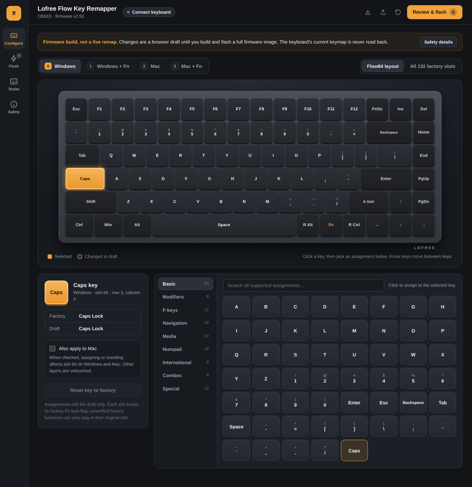
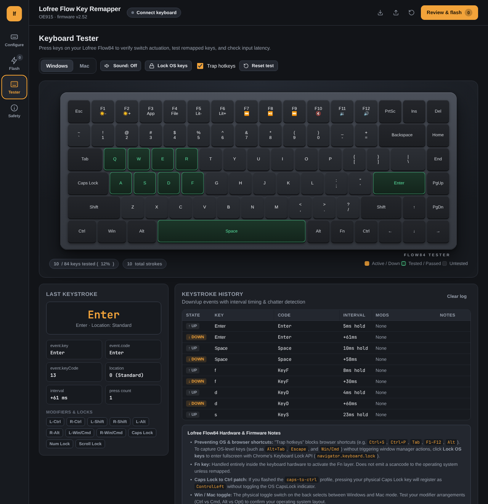
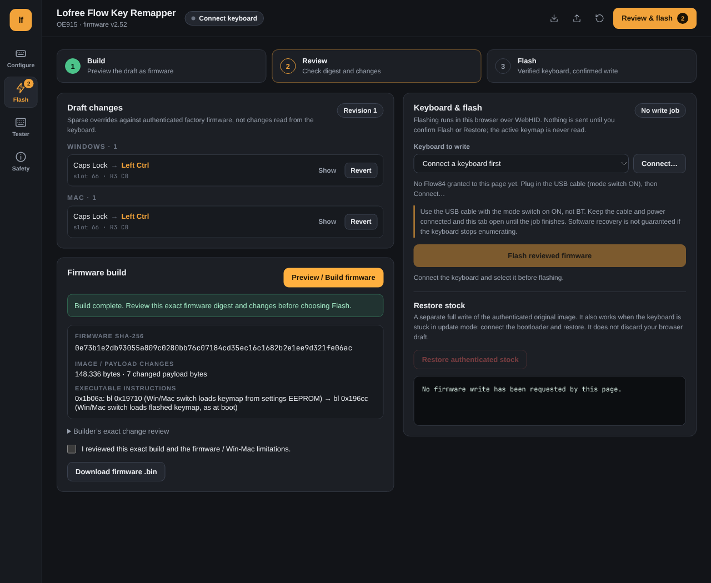

# Lofree Flow Key Remapper

A browser-based visual key remapper, interactive switch tester, and WebHID firmware flasher for the **Lofree Flow84 (OE915)** mechanical keyboard.

🚀 **Live Web App:** **[https://ennis-ma.github.io/lofree-flow-key-remapper/](https://ennis-ma.github.io/lofree-flow-key-remapper/)**

---

## Overview

The Lofree Flow84 is a popular low-profile mechanical keyboard, but it lacks official QMK/VIA support or custom key remapping software. This project provides a complete open-source solution:

- **100% Browser-Based**: Everything runs locally in your browser using modern WebHID. No drivers, software installations, servers, or Python required.
- **Firmware Attached**: The authenticated stock firmware (`CompxUpgradeBinFile.bin`) is pre-bundled in the web app and loads automatically when you open the page—no file picker or extra click.
- **Onboard Persistence**: Remappings are compiled into the firmware and remain active across reboots and different computers.
- **Win / Mac Switch Survival**: Includes a verified call patch so toggling the physical Win/Mac switch keeps your custom keymap active.
- **Interactive Switch Tester**: Built-in 84-key layout tester with latency measurement, modifier status lights, and switch bounce/chatter detection.
- **Stock Restoration**: Restore the byte-identical original firmware while the keyboard remains accessible over USB. Recovery is not guaranteed.

---

## Main Features & Screenshots

### 1. Visual Keymap Editor
Configure custom keys across all 4 hardware layers (**Windows**, **Windows + Fn**, **Mac**, and **Mac + Fn**) with a rendered Flow84 layout. Choose from standard keys, modifiers, media controls, navigation, and custom modifier combinations.



- **Searchable action picker**: Quickly find any key or multimedia action.
- **Combo builder**: Create single keys that trigger modifier combinations (e.g., `Ctrl + Shift + Esc`).
- **Profile import & export**: Save and share your keymap configurations as JSON.

---

### 2. Interactive Key Tester
Check key events from your Flow84 and verify remapped keys. The screenshot uses automated example keystrokes; it is not a physical switch test. Timing shows intervals between browser events, not hardware input latency.



- **Real-time actuation**: Tested keys light up in green upon actuation, with hit-count badges for repeated presses.
- **Switch chatter detector**: Automatically detects and warns if a switch bounces or chatters (<25 ms re-actuation).
- **Latency & interval timer**: Displays elapsed time in milliseconds between keystrokes.
- **Live modifier matrix**: Real-time status chips for `Ctrl`, `Shift`, `Alt`, `Win/Cmd`, `Caps Lock`, `Num Lock`, and `Scroll Lock`.
- **Trap hotkeys & Lock OS keys**: Prevents browser shortcuts (`Ctrl+S`, `Ctrl+P`, `Tab`, `F-keys`) from stealing focus while testing, with an optional fullscreen Keyboard Lock mode for system-level keys (`Alt+Tab`, `Escape`, `Super`).

---

### 3. Review & WebHID Flasher
Inspect exact firmware byte modifications, review cryptographic SHA-256 digests, and safely flash your custom firmware directly over a USB cable.



- **Zero guess-work**: Review a human-readable list of every modified key before flashing.
- **Automated bootloader handoff**: Chromium automatically prompts for the bootloader (`3554:f800`) when the keyboard restarts into update mode.
- **Stock restoration**: Restore the byte-identical vendor firmware, including from a recognized bootloader. Recovery is not guaranteed if the keyboard stops appearing over USB.

---

## Quick Start (Web App)

1. Open **[https://ennis-ma.github.io/lofree-flow-key-remapper/](https://ennis-ma.github.io/lofree-flow-key-remapper/)** in Chrome, Edge, Brave, or Opera.
2. The authenticated stock firmware loads automatically on first visit.
3. Select a layer (**Windows** or **Mac**) → Click a key on the keyboard → Pick your desired assignment.
4. Go to **Review & flash** → Click **Preview / Build firmware**.
5. Connect your keyboard using a **USB-C cable** with the physical switch set to **ON** (not BT).
6. Click **Connect keyboard**, choose your Flow84, acknowledge the safety notice, and click **Confirm flash**.
7. Keep the cable connected until the progress bar reaches 100%.

---

## Popular Pre-built Image: Caps Lock → Control

If you just want **Caps Lock mapped to Left Ctrl** (a popular layout for developers, Vim, and Emacs users) without opening the UI, you can flash the tested pre-built image directly:

- Configuration: `profiles/caps-to-ctrl.json`
- Pre-built binary: `images/caps-to-ctrl-v2.52.bin`
- Expected SHA-256: `0e73b1e2db93055a809c0280bb76c07184cd35ec16c1682b2e1ee9d321fe06ac`

---

## Command Line Tools (Python)

For developers and Linux terminal users, the repository includes command-line tools:

### Build a custom firmware image
```sh
# Build from a JSON profile
python3 -B oe915_patch.py build --profile profiles/caps-to-ctrl.json -o images/my-custom-firmware.bin

# Validate an image
python3 -B oe915_patch.py validate images/my-custom-firmware.bin
```

### Inspect and flash via Linux CLI
```sh
# Read-only inspect USB ports and permissions
python3 -B oe915_linux.py inspect

# Flash your custom image (replace 3-3 with your actual port from inspect)
python3 -B oe915_linux.py flash --port 3-3 --image images/caps-to-ctrl-v2.52.bin

# Restore stock firmware
python3 -B oe915_linux.py flash-stock --port 3-3
```

---

## Safety & Recovery Notes

- **Always use USB Cable with switch on ON**: Flashing cannot and should not be done over Bluetooth.
- **Never unplug during flashing**: Keep the USB cable connected until the firmware write is confirmed.
- **Stock Recovery**: If a flash is interrupted or stops in bootloader mode, connect the bootloader device in the web app and click **Restore authenticated stock** (or run `oe915_linux.py flash-stock`).
- **Linux hidraw access**: On Linux, ensure your user account has access to hidraw nodes (standard systemd `uaccess` rules).

---

## Verification & Tests

Run the offline test suite:
```sh
# Test profile builder and safety boundaries
python3 -B -m unittest test_oe915_profiles

# Test JavaScript core parity and simulated bootloader upload
node --test web/

# Verify stock container integrity
python3 -B oe915_fw.py verify CompxUpgradeBinFile.bin
```

---

## Hardware Compatibility

- **Device**: Lofree Flow84 (OE915)
- **MCU**: CX53710
- **Firmware**: Stock v2.52
